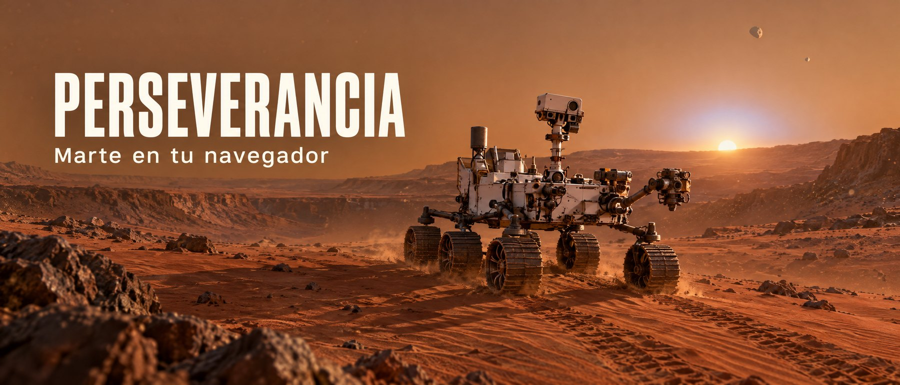
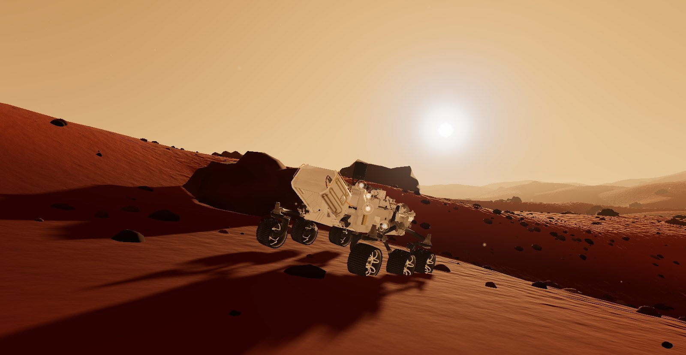
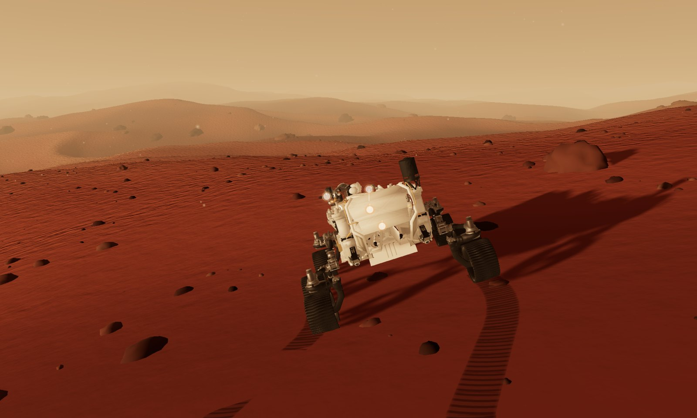
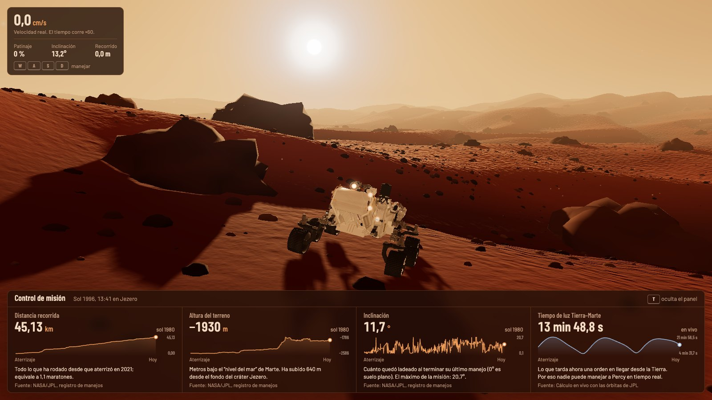
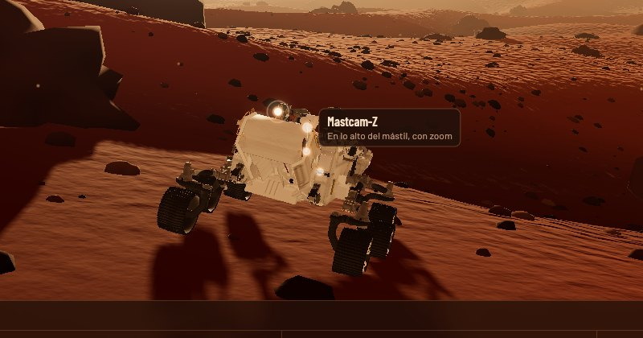
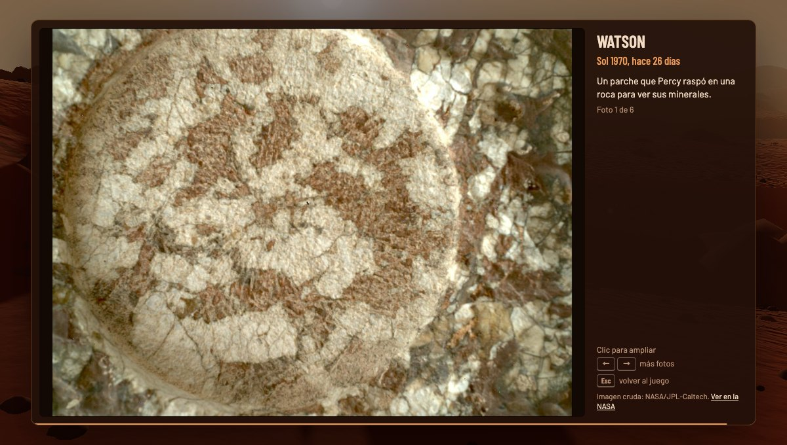
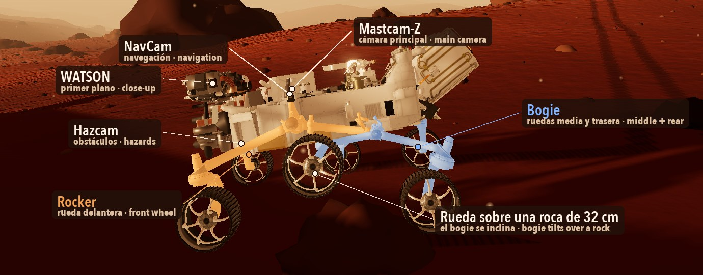
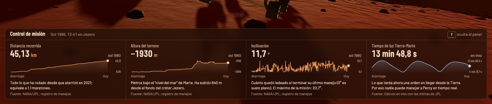

<p align="center">
  
</p>

# Perseverancia: proyecto realizado en el curso de Claude Code para programadores de Platzi con el profesor Felipe Guarin

**Maneja el rover Perseverance de la NASA por Marte, desde tu navegador.**

Es una simulación 3D hecha con [Three.js](https://threejs.org) que mezcla un juego con datos de verdad: el rover se mueve con la mecánica del Perseverance real, el control de misión muestra datos reales de la NASA y sus cámaras abren fotos reales que Percy tomó en Marte en los últimos días.

<p align="center">
  
</p>

## Qué puedes hacer

|  |  |
|---|---|
|  | **Manejar el rover.** Las seis ruedas giran, las cuatro de las esquinas se orientan y la suspensión *rocker-bogie* sube rocas de hasta 52,5 cm. En arena empinada patina, como le pasa al real. |
|  | **Ver el control de misión.** Distancia recorrida, altura del terreno e inclinación del registro de manejos de la NASA, y el tiempo que tarda la luz entre la Tierra y Marte, calculado en vivo. |
|  | **Usar las cámaras de Percy.** Mastcam-Z, NavCam, Hazcam y WATSON brillan sobre el modelo. Haz clic en una y la foto llega línea a línea, como baja desde Marte. |
|  | **Mirar fotos reales.** Cada foto dice qué cámara la tomó, en qué sol y hace cuántos días. Usa las flechas para ver más y Esc para volver al juego. |

## Pruébalo en 2 minutos

Necesitas [Node.js](https://nodejs.org) 20 o superior.

```bash
git clone https://github.com/anarotela18/perseverancia.git
cd perseverancia
npm install
npm run dev
```

Abre <http://localhost:5173> y listo.

| Tecla | Qué hace |
|---|---|
| <kbd>W</kbd> <kbd>S</kbd> | Avanzar y retroceder |
| <kbd>A</kbd> <kbd>D</kbd> | Girar (solas: gira sobre sí mismo; con W: en arco) |
| <kbd>T</kbd> | Mostrar u ocultar el control de misión |
| Mouse | Mover la cámara alrededor del rover |
| Clic en un punto brillante | Tomar una foto con esa cámara |
| <kbd>←</kbd> <kbd>→</kbd> / <kbd>Esc</kbd> | Más fotos / volver al juego |

## Cómo funciona, en simple

<p align="center">
  
</p>

- **El terreno** se genera con ruido matemático: dunas, colinas y rocas, siempre iguales en cada carga.
- **El rover** usa la suspensión *rocker-bogie* del real. El *rocker* (ámbar) sostiene la rueda delantera; el *bogie* (azul), la del medio y la trasera. Así, cuando una rueda sube a una roca, las otras cinco siguen en el suelo y el cuerpo apenas se inclina.
- **La velocidad es real**: 4,2 cm/s. Como eso sería muy lento para jugar, el reloj del rover corre 60 veces más rápido, y el tablero lo dice.
- **El control de misión** usa el patrón de telemetría de [Open MCT](https://nasa.github.io/openmct/), la herramienta de la NASA: cada dato tiene nombre, unidad y un proveedor que sabe traer su historial.
- **Las fotos** se escogieron a mano entre ~2.600 imágenes crudas de los últimos soles, buscando que se sienta Marte: horizontes, el brazo sobre el suelo y rocas de cerca.

## Datos reales que usa

<p align="center">
  
</p>

| Dato | De dónde sale |
|---|---|
| Distancia, altura e inclinación | [Registro de manejos de Perseverance](https://mars.nasa.gov/mmgis-maps/M20/Layers/json/M20_waypoints.json) (NASA/JPL) |
| Tiempo de luz Tierra–Marte | Calculado en vivo con los elementos orbitales de JPL |
| Fotos | [API de imágenes crudas de Mars 2020](https://mars.nasa.gov/mars2020/multimedia/raw-images/) (NASA/JPL-Caltech) |


## Créditos

- Datos y fotos: NASA/JPL-Caltech y ASU (Mastcam-Z). Fotos crudas, sin procesar.
- El banner y la ilustración de "Construye encima" fueron generados con IA. Las demás imágenes son capturas reales del juego.
- Este es un proyecto de la comunidad, **no está afiliado a la NASA**.
- Código bajo [licencia MIT](LICENSE).